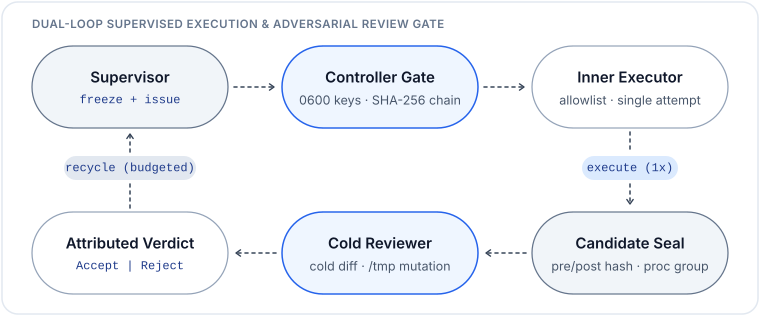

# Dual-Loop Dev (`dual-loop-dev`)

[中文主文档](README.md) · [**📄 Shareable Technical Overview (EN)**](docs/OVERVIEW.en.md) · [**🤖 Cloud/Local AI Agent Playbook (`AGENTS.md`)**](AGENTS.md) · [`SKILL.md`](SKILL.md) · [Architecture & Boundaries](references/architecture.md) · [Workflow Tiers](references/workflow-tiers.md) · [Failure Casebook](references/failure-casebook.md)

**A zero-dependency, deterministic supervised development gate and universal Agent Skill for AI coding agents.**

Single-loop coding agents (*"edit -> run tests -> weaken assertions or hack around failures -> self-declare success"*) routinely break down on multi-module refactors and long-horizon roadmaps. Built strictly on the **Python 3.10+ standard library and Git**, `dual-loop-dev` splits automated software engineering into two hard-enforced loops and three cryptographically separated roles:

1. **Inner Execution Loop (`executor`)**: Receives a frozen prospective contract and an explicit allowlist of writable paths, implements the change in one pass, and runs `execute` **at most once**. Failed checks consume the attempt and seal the candidate—never authorizing silent retries or assertion weakening.
2. **Outer Governance Loop (`supervisor` + cold `reviewer`)**: Freezes contracts and baselines, dispatches a fresh-context independent reviewer to cold-read diffs and run `/tmp` mutation/counterexample probes, classifies rejections (`code` vs. `contract` vs. `environment`), recycles within a monotonically non-increasing round budget, and orchestrates multi-task DAG roadmaps inside isolated Git worktrees.

> **🤖 For Cloud & Remote AI Agents Reading This Repository Directly** (Codex Cloud, Claude Code Web, Cursor Background Agent, Devin, Antigravity):  
> Read [**`AGENTS.md`**](AGENTS.md) (and [`SKILL.md`](SKILL.md)) first. No `pip install` or PyPI access is required—clone this repo outside the target codebase (e.g. `/tmp/dual-loop-dev`) and follow the step-by-step CLI commands and minimal valid JSON payloads in `AGENTS.md`.
>
> **📢 Sharing with your team or community?** Read and share the standalone [**English Technical Overview & Deep Dive (`docs/OVERVIEW.en.md`)**](docs/OVERVIEW.en.md).



---

## Key Capabilities

- **Cryptographically Separated Local Role Tokens**: `supervisor.key`, `executor.key`, and `reviewer.key` (`0600`) physically block self-approval, role confusion, and silent retries.
- **Immutable Candidate Sealing, Bytecode Isolation & Process-Group Reaping**: Before check #1 runs, `controller.py` seals a SHA-256 source snapshot (`candidate.json`) and re-verifies it before and after *every* check—validation gates can never silently mutate or auto-format source code. Checks run with `PYTHONDONTWRITEBYTECODE=1` and a disposable external `PYTHONPYCACHEPREFIX` inside isolated POSIX process groups (`start_new_session=True`), cleanly reaping descendant processes on timeout (`124`) or `SIGINT`/`SIGTERM`.
- **Tamper-Evident Hash Ledger & $O(N)$ Offline Replay**: Every transition is `fsync`-recorded in a SHA-256 hash chain (`events.jsonl`), and each `rounds/NNN/` archive stores self-contained copies of contracts, policies, `profile.json`, logs, review evidence, and the contract engine script—verifiable offline with an artifact-seal-keyed replay cache (`.verified-cache.json` + `--full-replay`).
- **Built-in Zero-Dependency Contract Engine + TaskKit Compatibility**: Ships with `scripts/contract.py` (`init-case / freeze / check / compare / replay`) out of the box while remaining drop-in compatible with external [TaskKit](https://github.com/abuttoncc/agent-taskkit) v0.5 (`taskkit_script`).
- **Fault-Tolerant Orchestrator & Attribution-Aware Recovery**:
  - `orchestrator.py` dispatches `claude`, `codex`, or custom command backends using ephemeral per-round worker tokens (`worker-tokens/`), auto-submits forgotten `execute` calls, and losslessly retries interrupted read-only reviewers.
  - Routes rejections by root cause: preserves candidate code untouched on `ATTRIBUTION: contract` (supporting `contract_repair_command` hot-fixes), and archives + reverts unauthorized out-of-scope edits before `recycle` on `ATTRIBUTION: code`.
- **Unattended Multi-Task DAG Daemon & Ledger-Verified Integration**:
  - `roadmap.py` validates DAG topologies (Kahn cycle detection), isolates execution in external Git worktrees + leased TCP ports, snapshots dirty failed worktrees (`uncommitted-snapshot/`) when `continue_independent_on_failure: true`, and maintains a live `progress.md` board.
  - `worktree.py integrate --state-dir` cross-verifies commit review trailers, hash-chained `accepted` rounds, and Git blob SHA-256 trees against sealed `candidate.json` before merging.

---

## 30-Second Quickstart

Run the self-contained 2-task DAG demo (no LLM API keys required—simulates a Round 1 cold-review adversarial rejection despite passing unit tests, automatic Round 2 recycle & acceptance, and ledger-verified Git worktree integration):

```bash
git clone https://github.com/hanlinlibham/dual-loop-dev.git
cd dual-loop-dev

# Run the end-to-end 2-task DAG demo
python3 examples/minimal-project/run_demo.py

# Run the full adversarial unit & integration test suite
python3 -m unittest discover -s tests -p "test_*.py" -v
```

---

## Installation

### 1. As a CLI Tool

```bash
pip install -e .
dual-loop --help
```

### 2. As a Universal Agent Skill (Claude Code / Cursor / Codex / Antigravity)

```bash
mkdir -p ~/.agents/skills
git clone https://github.com/hanlinlibham/dual-loop-dev.git ~/.agents/skills/dual-loop-dev

# Optional for Claude Code local skills directory:
# git clone https://github.com/hanlinlibham/dual-loop-dev.git ~/.claude/skills/dual-loop-dev
```

---

## Prompt Templates for Continuous Iterative Delivery in a New Codebase

Copy and paste any prompt below into your coding agent when entering a **brand-new repository** to drive disciplined, multi-round optimization and delivery:

### Cloud / Ephemeral Sandbox Mode (Zero Pre-Install — Just Paste the Repo URL)

```markdown
Clone or read https://github.com/hanlinlibham/dual-loop-dev outside this repository (e.g. `/tmp/dual-loop-dev`) and follow its root `AGENTS.md` and `SKILL.md` instructions to continuously iterate on and deliver [<YOUR OBJECTIVE>] in the current codebase:
1. Run read-only discovery (`preflight.py`, baseline tests/metrics, `.gitignore` cache check, and `profile.json` setup), then decompose the goal into 2–5 small staged packages with a clear stop rule.
2. Create an external Git worktree via `worktree.py create` and store all control/authority/case directories outside the target repo.
3. Execute each package through the full `contract.py` + `controller.py` dual loop (frozen contract -> `issue` -> single-attempt `execute` -> fresh cold `review` with `/tmp` counterexample probes -> attributed `recycle` within `max_rounds=3` if rejected -> local commit with `Accepted in supervised round <case> (review <hash8>)` trailer).
4. Once all packages pass, verify trailers and sealed candidate trees via `worktree.py integrate --state-dir`, print exact Git stats via `summary.py`, and report before/after metrics without pushing unless asked.
```

### Template A: Local Interactive Supervisor Mode (When Skill Is Already Installed)

```markdown
Use the `dual-loop-dev` skill and act as the outer-loop Supervisor to continuously iterate on and deliver [<YOUR OBJECTIVE, e.g., parser performance optimization / module decoupling / auth boundary hardening>] in this repository:

1. **Read-Only Discovery & Baseline Setup**:
   - Run `preflight.py` first. Inspect the architecture, existing test/build commands, and `.gitignore` (ensure build artifacts and `__pycache__/` are git-ignored so validation checks never pollute source snapshots).
   - If `profile.json` does not exist yet, identify critical paths that must remain untouched and create `profile.json` (`"require_clean_worktree": true`).
   - Measure and record the current baseline (test status, benchmark numbers, or reproduction evidence) before planning any edits.

2. **Staged Roadmap Decomposition**:
   - Break the objective into 2–5 small, independently verifiable work packages. Assign each package a tier (`L1/L2/L3`), an explicit `allowed_paths` allowlist, deterministic `checks`, measurable `expected.csv` criteria, and a clear overall stop rule.

3. **Isolated Worktree & Dual-Loop Execution per Package**:
   - Create an external Git worktree (and leased port if needed) via `worktree.py create`; do not edit the primary branch directly.
   - For each package: freeze the contract (zero unresolved `investigate` rows) -> `issue` -> dispatch an inner Executor subagent to implement within `allowed_paths` and call `execute` at most once -> dispatch a **fresh-context** cold Reviewer subagent to re-run checks, cold-read the diff, and run `/tmp` mutation/counterexample probes.
   - If rejected, classify root cause (`ATTRIBUTION: code | contract | environment`) and `recycle` using `review_hash` within `max_rounds=3` without weakening tests.

4. **Ledger-Verified Integration & Audited Delivery**:
   - After each `accept`, commit locally in the isolated worktree with the `Accepted in supervised round <case> (review <hash8>)` trailer and proceed to the next package.
   - Once all packages meet the stop rule, run `worktree.py integrate --state-dir` to verify trailers + sealed `candidate.json` trees and fast-forward merge (or keep the branch ready for inspection), compute final stats with `summary.py`, and report before/after metrics. Do not `git push` or restart production services without explicit confirmation.
```

### Template B: Unattended Roadmap / Nightly Daemon Mode

```markdown
Use the `dual-loop-dev` skill to inspect this repository read-only, create `profile.json` if missing, and decompose [<YOUR SPEC OR ROADMAP>] into a multi-task DAG file at `../roadmap-state/roadmap.json` conforming to `schemas/roadmap.schema.json` (`"isolate_worktree": true`, explicit `allowed_paths`, `checks`, `criteria`, and `depends_on`, using `<claude or codex>` backends).

Once validated, run `dual-loop roadmap run --roadmap ../roadmap-state/roadmap.json --state-dir ../roadmap-state` (or `daemon` mode), and report the generated `progress.md` summary and isolated branch status when finished.
```

---

## How `dual-loop-dev` Differs from Ordinary Skills & Connects with TaskKit

| Dimension | Ordinary Agent Skill (`SKILL.md` only) | `dual-loop-dev` (This Framework) | Macro Workspace Harness (e.g., [TaskKit](https://github.com/abuttoncc/agent-taskkit)) |
|---|---|---|---|
| **Enforcement** | **Soft prompt guidance**: relies on LLM compliance; prone to silent retries, weakened assertions, and self-approval in long sessions | **Hard cryptographic & state-machine gates**: separated `0600` role keys, pre/post-check SHA-256 `candidate.json` sealing, and hash-chained `events.jsonl` | **Handoff & lifecycle order**: cross-session task folders, `handoffs/` checkpoints, and frozen deliverable protection |
| **Execution Model** | Passive instructions inside a chat session | **Tri-modal**: works as an in-session Skill, an outer CLI orchestrator/daemon dispatching `claude` / `codex` workers, and a zero-install cloud self-bootstrap workflow | Workspace-level task tracking & milestone indexing |
| **Interoperability** | Domain skills (framework specs, UI rules) plug into `profile.json` `docs` and `policy_files` to be hash-frozen and audited by the cold Reviewer | Governs the inner/outer code-change loop, Git worktree isolation, and adversarial verification | Shares the exact `spec.json` + `expected.csv` contract protocol—use TaskKit for macro project handoffs and `dual-loop-dev` for supervised code execution |

---

## Usage Guide

### 1. Add `profile.json` to Target Repository

Decouple repository-specific protected paths and preflight settings in `profile.json` (schema: [`schemas/profile.schema.json`](schemas/profile.schema.json)):

```json
{
  "schema_version": 1,
  "name": "my-project",
  "protected_paths": ["core/", "migrations/", "profile.json"],
  "require_clean_worktree": true,
  "preflight": { "port": 3000 },
  "docs": ["ARCHITECTURE.md"]
}
```

### 2. Mode 1: Single-Task Automated Outer-Loop Orchestrator (`dual-loop orchestrate`)

Supports `"kind": "claude"` (Claude Code CLI), `"kind": "codex"` (Codex CLI), or `"kind": "command"` (any custom script):

```bash
dual-loop orchestrate --task-config task.json --state-dir ../task-state/auth-guard
```

### 3. Mode 2: Multi-Task DAG Roadmap & Unattended Daemon (`dual-loop roadmap`)

Write `roadmap.json` (schema: [`schemas/roadmap.schema.json`](schemas/roadmap.schema.json)):

```bash
# Run all ready tasks in topological order inside an external Git worktree
dual-loop roadmap run --roadmap roadmap.json --state-dir ../roadmap-state

# Daemon mode: continuously watch roadmap.json with flock lock and heartbeat file
dual-loop roadmap daemon --roadmap roadmap.json --state-dir ../roadmap-state --poll-interval 15

# Inspect live status and generated progress.md board
dual-loop roadmap status --state-dir ../roadmap-state

# Cross-verify commit trailers, hash-chained ledgers, and sealed candidate.json trees, then merge
dual-loop worktree integrate --repo . --worktree <isolated_worktree_path> --state-dir ../roadmap-state
```

### 4. Mode 3: Granular State-Machine CLI (`dual-loop controller`)

```bash
dual-loop preflight --repo . --workspace ..
dual-loop controller init --root "$CTRL" --authority "$AUTH"
dual-loop contract init-case --root "$CASE" --topic fix-parser --question "Fix edge case" --criteria-json criteria.json
dual-loop contract freeze --root "$CASE"
dual-loop controller issue --root "$CTRL" --token "$AUTH/supervisor.key" --manifest manifest.json
dual-loop controller execute --root "$CTRL" --token "$AUTH/executor.key"
dual-loop contract compare --root "$CASE" --observations outputs/obs.json --out outputs/review-comparison.json
dual-loop controller review --root "$CTRL" --token "$AUTH/reviewer.key" --verdict accept --feedback feedback.md --report outputs/review-comparison.json
```

---

## Repository Layout

| Path | Description |
|---|---|
| [`docs/OVERVIEW.en.md`](docs/OVERVIEW.en.md) | Shareable English technical overview, design philosophy, and under-the-hood deep dive |
| [`AGENTS.md`](AGENTS.md) / [`CLAUDE.md`](CLAUDE.md) | Zero-install self-bootstrap playbook for cloud and local AI coding agents |
| [`SKILL.md`](SKILL.md) | Universal Agent Skill entrypoint (tier selection, preflight, 3-role loop) |
| [`dual_loop/cli.py`](dual_loop/cli.py) | Unified `dual-loop` CLI dispatcher |
| [`scripts/contract.py`](scripts/contract.py) | Zero-dependency prospective contract engine (TaskKit v0.5 compatible) |
| [`scripts/controller.py`](scripts/controller.py) | Single-attempt state machine, candidate sealing, process-group reaping, and hash-chain archive |
| [`scripts/worktree.py`](scripts/worktree.py) | Isolated Git worktree manager, TCP port leases, `LOCK`, and ledger-verified integration |
| [`scripts/orchestrator.py`](scripts/orchestrator.py) | Single-task outer-loop orchestrator (scoped worker keys, auto-submit, attribution routing) |
| [`scripts/roadmap.py`](scripts/roadmap.py) | Multi-task DAG runner & unattended daemon (cycle detection, `progress.md`, snapshot recovery) |
| [`scripts/preflight.py`](scripts/preflight.py) | Read-only occupancy check for active ledgers, `LOCK` files, recent sessions, and TCP ports |
| [`scripts/summary.py`](scripts/summary.py) | Deterministic Git audit summary with supervised-round trailer verification |
| [`schemas/`](schemas/) | JSON Schemas for `profile`, `manifest`, `roadmap`, and `rule-proposal` |
| [`references/`](references/) | Architecture boundaries, L1/L2/L3 tiers, brief templates, failure casebook, and rule evolution |
| [`examples/minimal-project/`](examples/minimal-project/) | Self-contained 2-task DAG end-to-end runnable demonstration |
| [`tests/`](tests/) | Adversarial test suite covering unauthorized roles, tampering, timeouts, replay, and DAG recovery |

---

## Security Boundary

`dual-loop-dev` is a **trusted-local workflow guard**, not an OS sandbox against hostile code running under the same user UID. A malicious script running as the same OS user can bypass the CLI or inspect parent directories. For untrusted workers, keep `control/`, `authority/`, and policies on the host outside the worker container/VM, and mount only a read-only brief and scoped writable worktree inside the worker.

---

## License

[MIT](LICENSE)
