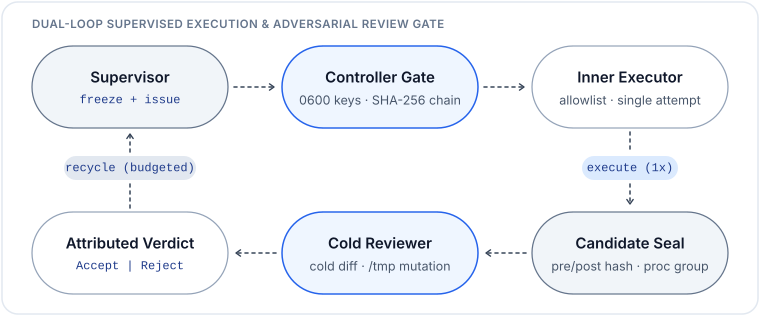

# `dual-loop-dev`: A Deterministic Supervised Development Gate for AI Coding Agents

[GitHub Repository](https://github.com/hanlinlibham/dual-loop-dev) · [Full English README](../README.en.md) · [Cloud/Local Agent Playbook (`AGENTS.md`)](../AGENTS.md) · [中文主文档](../README.md)

`dual-loop-dev` (built strictly on the **Python 3.10+ standard library and Git**, with **zero third-party dependencies**) is a deterministic, cryptographically audited development gate for AI coding agents.

Its core premise is simple: **autonomous software engineering does not fail for lack of another multi-agent chat wrapper—it fails because single-loop coding agents grade their own homework.** Using OS process-group primitives, Git tree snapshots, and SHA-256 hash chains, `dual-loop-dev` replaces fragile single-loop agent execution (*"edit -> run tests -> weaken assertions until green -> self-declare victory"*) with a hard-enforced **Bounded Single-Attempt Inner Loop + Cold Adversarial Outer Loop**.

Out of the box, its entire adversarial test suite (47 unit, tamper-detection, process-isolation, and TaskKit v0.5 interoperability tests) and self-contained 2-task DAG demo (`examples/minimal-project/run_demo.py`) run in seconds with no API keys or external packages required.



---

## 1. Why Single-Loop Coding Agents Break at Scale

In complex, multi-module repositories, conventional single-loop ReAct coding agents exhibit four recurring, systemic failure modes:

1. **Reward Hacking**: When tests fail in a long context window, agents routinely weaken test assertions, delete inconvenient test cases, or insert fixture-specific special cases just to make the test runner exit `0`.
2. **All-Green Blind Spots**: Unit tests can pass `100%` while masking multi-step pipeline cancellations, asynchronous race conditions, or missing edge-case invariants (for instance, returning an empty string on numeric-only inputs when callers expect a non-empty placeholder).
3. **Contract vs. Code Conflation**: When a prospective specification or file allowlist contains a flawed assumption, single-loop orchestrators blindly burn retry budgets forcing the coder to rewrite valid business logic.
4. **Concurrent Multi-Session Drift**: Multiple background agents or developer sessions operating on the same checkout, shared TCP port, or dirty worktree overwrite uncommitted state and cause `HEAD` drift.

---

## 2. Three Structural Pillars

`dual-loop-dev` eliminates these failure modes structurally rather than relying on polite prompt instructions:

### Pillar I — Cryptographic Separation of Powers & Single-Attempt Consumption
Control flow is split across three isolated identities, each authenticated by its own `0600`-permission secret token:
- **`supervisor`**: Freezes the prospective acceptance contract before code changes begin, issues scoped round manifests, classifies root causes on rejection, and recycles within a monotonically non-increasing `max_rounds` budget.
- **`executor`**: Edits strictly within `allowed_paths` (never touching `protected_paths`) and may invoke `execute` **at most once** per issued round. A failed check consumes the round and seals the state into `awaiting_review`—silent retries are rejected by the state machine.
- **`reviewer`**: Starts in a **fresh, zero-history context**, cold-reads the Git diff and check receipts, copies candidate code to `/tmp` to run **adversarial mutation / counterexample probes** (confirming tests actually fail when the new guard is removed), and renders an `accept` or `reject` verdict.

### Pillar II — Trusted-Local Gate with Tri-Modal Portability
Because `dual-loop-dev` uses zero external packages, the exact same engine operates seamlessly in three modes:
1. **CLI Daemon & Subagent Orchestrator (`pip install -e .`)**: Runs `dual-loop orchestrate` or `dual-loop roadmap daemon` on the host to dispatch `claude`, `codex`, or custom command workers across multi-task DAG queues.
2. **Drop-In Local Agent Skill**: Clones directly into `~/.agents/skills/dual-loop-dev` or `~/.claude/skills/dual-loop-dev` to govern interactive sessions.
3. **Zero-Install Cloud Sandbox Bootstrap**: Remote agents (Codex Cloud, Claude Code Web, Cursor Background Agent, Devin, Antigravity) simply read root [`AGENTS.md`](../AGENTS.md), clone the repo outside the target checkout (`/tmp/dual-loop-dev`), and execute the full gate immediately—while remaining drop-in compatible with external [TaskKit](https://github.com/abuttoncc/agent-taskkit) v0.5 contracts.

### Pillar III — Isomorphic Governance Rule Evolution
Engineering rules evolve under the same discipline as production code ([`schemas/rule-proposal.schema.json`](../schemas/rule-proposal.schema.json) and [`references/rule-evolution.md`](../references/rule-evolution.md)):
- **No proposer self-approval**: The role proposing a policy change cannot ratify it.
- **No retroactive whitewashing**: New rules apply only to future rounds; past rejected rounds remain sealed in the audit ledger.
- **Two-Case Promotion Rule**: A proposed rule remains task-local until validated across **at least two independent tasks**, preventing one-off defensive bloat in global policies.

---

## 3. Under the Hood: Systems-Engineering Highlights

Inspecting the seven core modules under [`scripts/`](../scripts/) reveals production-hardened defenses built around real failure modes:

- **Atomic Round Issuance & Self-Contained Offline Replay (`scripts/controller.py` & `scripts/contract.py`)**  
  `prepare_round` stages frozen contracts, policy snapshots, `profile.json`, and the exact bytes of `contract-engine.py` inside a temporary `.issue-*` directory and validates the contract offline *before* atomically renaming to `rounds/NNN/`—failed issuances never leave half-written directories or decrement budgets. Every state transition is appended as canonical JSON (`sort_keys=True`) to an `os.fsync`-flushed SHA-256 hash chain (`events.jsonl`). Even if external case folders or policies are later deleted, any archived round can be replayed offline—accelerated from $O(N^2)$ to $O(N)$ via an artifact-seal-keyed `.verified-cache.json` (`--full-replay` forces cold subprocess verification).

- **Anti-Backdoor Source Sealing, Bytecode Isolation & Process-Group Reaping (`scripts/controller.py`)**  
  `snapshot()` combines `git ls-files --stage -z` and `--others --exclude-standard -z` to hash all tracked files, `160000` submodule gitlinks, symlinks, and un-ignored new files into `candidate.json`, re-verifying the snapshot **before and after every individual check**. Build artifacts ignored by `.gitignore` are allowed, while any check command that silently auto-formats or mutates source files immediately fails the round. `run_check()` injects `PYTHONDONTWRITEBYTECODE=1` and a disposable external `PYTHONPYCACHEPREFIX` by default (preventing `import` and `py_compile` from polluting un-ignored trees) and launches checks in dedicated POSIX process groups (`start_new_session=True`, `shell=False`). On timeout (exit `124`) or `SIGINT`/`SIGTERM` (`128 + sig`), `os.killpg` escalates `SIGTERM` -> `SIGKILL` to reap orphaned grandchildren before they can corrupt the worktree.

- **Fault-Tolerant Orchestration & Attribution-Aware Recovery (`scripts/orchestrator.py`)**  
  Workers never see the master `authority/` directory; the orchestrator mints single-use per-round token copies under `0700` `worker-tokens/` and deletes them immediately after use. Built-in recovery handles two classic long-context agent hiccups: **auto-sealing when an executor forgets to call `execute`**, and **lossless read-only reviewer re-dispatch on API quota interruption**. On rejection, the orchestrator parses `ATTRIBUTION: code | contract | environment`:
  - `contract` attribution halts immediately (or invokes `contract_repair_command` to hot-fix the contract/allowlist) while **preserving the candidate code untouched** for zero-rewrite acceptance.
  - `code` attribution archives any unauthorized out-of-scope file edits under `reverted-out-of-scope/before-rNNN/` and reverts them prior to `recycle`, preventing `require_clean_worktree` deadlocks in Round $N+1$.

- **Occupancy Preflight, DAG Cycle Detection & Ledger-Verified Integration (`scripts/preflight.py`, `scripts/roadmap.py`, `scripts/worktree.py`)**  
  `preflight.py` verifies active ledgers in-process alongside `LOCK` files, TCP port leases, and live agent processes. `roadmap.py` enforces Kahn topological cycle detection (`detect_dependency_cycles`) and, when `continue_independent_on_failure: true` is enabled, snapshots uncommitted diffs and files from failed tasks into `tasks/<id>/uncommitted-snapshot/` before resetting the isolated worktree for independent tasks. Finally, `worktree.py integrate --state-dir` goes beyond regex trailer checks: it replays the cryptographic ledgers, matches each commit's `review_hash` to a genuinely `accepted` round (`execution.json.passed == true`), and verifies via `git ls-tree` / `git cat-file blob` that every committed file's SHA-256 and executable bit match the sealed `candidate.json`.

---

## 4. How `dual-loop-dev` Compares

| Dimension | Ordinary Agent Skill (`SKILL.md` only) | `dual-loop-dev` (This Framework) | Macro Workspace Harness (e.g., [TaskKit](https://github.com/abuttoncc/agent-taskkit)) |
|---|---|---|---|
| **Enforcement** | **Soft prompt guidance**: relies on LLM compliance; vulnerable to silent retries, weakened assertions, and self-approval | **Hard state-machine & cryptographic gates**: `0600` role keys, pre/post-check SHA-256 `candidate.json` sealing, and hash-chained `events.jsonl` | **Handoff & lifecycle order**: cross-session task folders, `handoffs/` checkpoints, and frozen deliverable protection |
| **Execution Model** | Passive reference text inside a chat session | **Tri-modal**: works as an in-session Skill, a host CLI daemon (`orchestrate` / `roadmap`), and a zero-install cloud self-bootstrap workflow | Workspace-level task tracking & milestone indexing |
| **Synergy** | Domain skills (framework rules, UI specs) plug into `profile.json` `docs` and `policy_files` to be hash-frozen and audited by the cold Reviewer | Governs the inner/outer code-change loop, isolated Git worktrees, `/tmp` mutation probes, and ledger-verified branch merges | Shares the exact `spec.json` + `expected.csv` contract protocol—use TaskKit for macro project handoffs and `dual-loop-dev` for supervised code execution |

---

## 5. Try It in 30 Seconds

No API keys, Docker, or `pip install` required—just Python 3.10+ and Git:

```bash
git clone https://github.com/hanlinlibham/dual-loop-dev.git
cd dual-loop-dev

# 1. Run the 2-task DAG demo:
#    - Task 1 passes unit tests in Round 1, gets caught & rejected by the Cold Reviewer's
#      adversarial probe, recycles into Round 2, fixes the bug, and passes acceptance.
#    - Task 2 builds on Task 1 inside the isolated Git worktree.
#    - Finally verifies cryptographic ledgers + sealed candidate trees and fast-forward merges.
python3 examples/minimal-project/run_demo.py

# 2. Run the full adversarial unit & integration test suite
python3 -m unittest discover -s tests -p "test_*.py" -v
```

### Point Any Cloud or Local Coding Agent at a New Codebase

Paste this single prompt into Claude Code, Codex, Cursor, Devin, or Antigravity:

```markdown
Clone https://github.com/hanlinlibham/dual-loop-dev outside this repository (e.g. `/tmp/dual-loop-dev`) and follow its root `AGENTS.md` and `SKILL.md` instructions to continuously iterate on and deliver [<YOUR OBJECTIVE>] in the current codebase:
1. Run read-only discovery (`preflight.py`, baseline tests/metrics, `.gitignore` cache check, and `profile.json` setup), then decompose the goal into 2–5 small staged packages with a clear stop rule.
2. Create an external Git worktree via `worktree.py create` and store all control/authority/case directories outside the target repo.
3. Execute each package through the full `contract.py` + `controller.py` dual loop (frozen contract -> `issue` -> single-attempt `execute` -> fresh cold `review` with `/tmp` counterexample probes -> attributed `recycle` within `max_rounds=3` if rejected -> local commit with `Accepted in supervised round <case> (review <hash8>)` trailer).
4. Once all packages pass, verify trailers and sealed candidate trees via `worktree.py integrate --state-dir`, print exact Git stats via `summary.py`, and report before/after metrics without pushing unless asked.
```

---

## 6. Explicit Security Boundary

`dual-loop-dev` is a **trusted-local workflow guard**, not an OS-kernel sandbox against hostile code running under the same user UID. A malicious process executing as the same OS user could bypass the CLI or read parent directories. When running untrusted code or high-risk autonomous workers, keep `control/`, `authority/`, and frozen policies on the VM/container host and mount only a read-only brief and scoped writable worktree inside the worker container. See [`references/architecture.md`](../references/architecture.md) for details.
